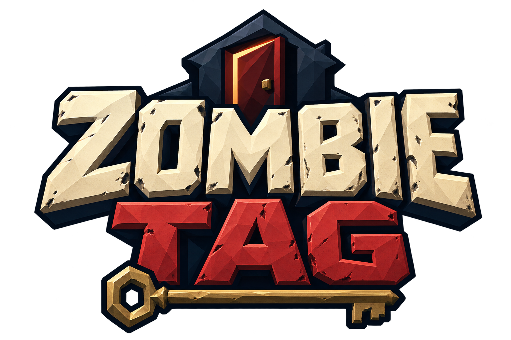

# Zombie Tag

A first-person multiplayer infection game inside a dark, furnished house. Humans search for a hidden key and escape; zombies hunt them. Fixed and generated houses, NPCs, character selection, proximity voice with wall muffling, and Steam friend lobbies.

[Download Windows and Linux builds](https://github.com/LazyAlgorithm/zombie-tag-releases/releases). Extract the entire ZIP, start Steam, then launch the game. The Tessera Hub also installs and updates these builds.

- WASD move, mouse look, Shift sprint, F flashlight, E interact, Escape menu.
- Zombies use an IK claw swipe with left click; AI uses the same contact timing. Infection turns players after a countdown; the host can set 0–10 seconds (default 3).
- Humans get an exit arrow and door outline after the key is found.
- **F8 toggles the temporary key-testing highlight**, visible only on your screen. Off by default.
- Solo Practice has no NPCs or time limit.
- Starts fullscreen. Settings offers flashlight brightness/beam size and separate Master, Music, Effects, Ambience and Player Voice sliders.
- Key sites are checked for exposed tops, clear overhead space and visibility from a reachable standing position.
- Original music/effects/ambience and experimental footsteps were generated locally with the installed AI tools. Grey smoke masks the networked zombie model switch.

Beta builds use Steam test App ID 480. Cross-account Steam relay/invitations and real-microphone listening remain manual validation items. Windows visual playtesting is pending.

Each release includes `ZombieTag-Windows.zip`, `ZombieTag-Linux.zip`, and `SHA256SUMS.txt`. Only validated runtime packages are published here; editable game source stays private. `build.json` records the source revision and engine release used by the latest successful build.

Generated branding lives in `artwork/`. Gameplay uses Synty packs owned by the project author. Their inclusion in compiled player builds grants no right to extract or redistribute them as an asset library. Third-party notices accompany the player.
